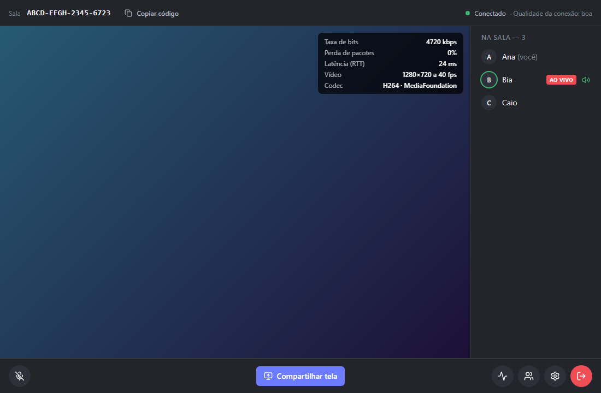
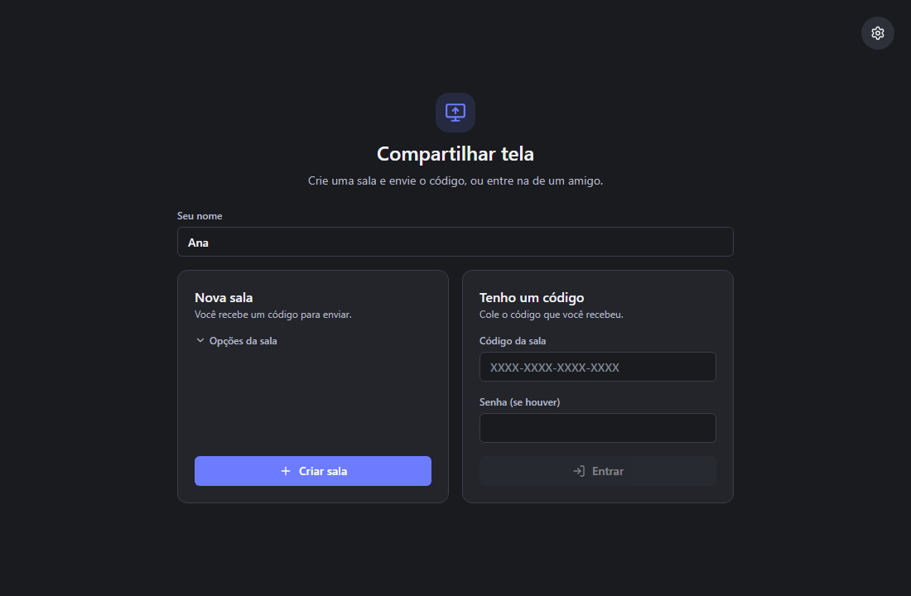
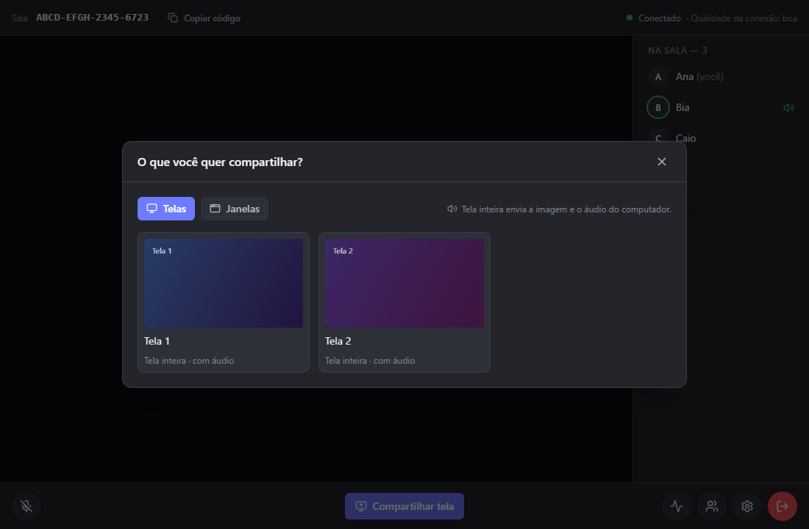
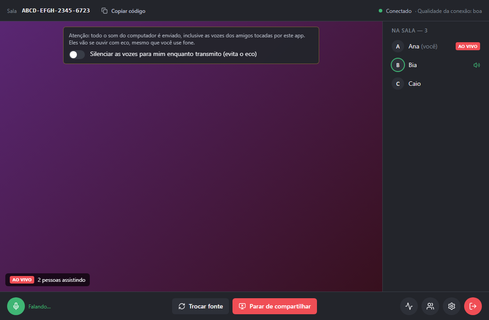
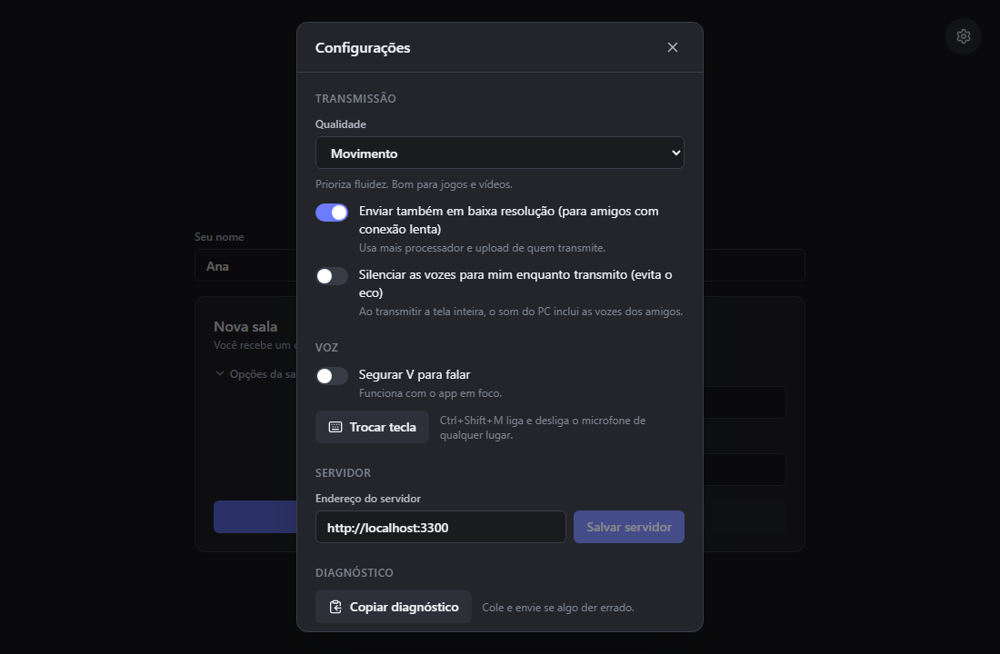

# Screen Share

App desktop (Windows 10/11, `.exe` portable) para compartilhar a tela com amigos, com o áudio do computador. Sem login: crie uma sala, envie o código, os amigos entram.



- **Tela e som do computador**, com alvo de 720p a 40 fps, por um servidor que você mesmo hospeda.
- **Sem conta e sem instalação:** um `.exe` portable e um código de sala.
- **Voz na mesma sala**, pelo botão do microfone ou por um atalho que funciona fora do app.
- **Métricas ao vivo** de resolução, fps, codec e latência, para saber o que está chegando.

## Telas

| Tela inicial                                                                                | Escolher o que compartilhar                                              |
| ------------------------------------------------------------------------------------------- | ------------------------------------------------------------------------ |
|  |  |

| Transmitindo                                                                                         | Configurações                                              |
| ---------------------------------------------------------------------------------------------------- | ---------------------------------------------------------- |
|  |  |

As imagens vêm da página de pré-visualização do projeto, com dados simulados (veja [Desenvolver](#desenvolver)).

## Usar

1. Baixe o `ScreenShare-portable.exe` da [última release](https://github.com/TrindadeThiago/screen-share/releases/latest). O Windows pode mostrar o aviso "app não reconhecido": _Mais informações → Executar assim mesmo_.
2. Digite seu nome e **Criar sala**; copie o código e envie. Para entrar, cole o código e clique em **Entrar**.
3. **Compartilhar tela** → escolha uma tela inteira (com áudio) ou uma janela (sem áudio).
4. **Eco:** ao transmitir uma tela inteira, o app envia todo o som do computador, inclusive as vozes dos amigos tocadas por ele; fone de ouvido não evita isso. Marque _Silenciar as vozes para mim enquanto transmito_ para eliminar o eco.
5. **Voz:** o botão do microfone, ou `Ctrl+Shift+M` de qualquer lugar, liga e desliga o microfone. Em **Configurações** dá para habilitar "segurar `V` para falar" e trocar a tecla.
6. **Deu problema?** _Copiar diagnóstico_, em **Configurações**, copia o log (sem códigos de sala) para você colar e enviar.

## Endereço do servidor

O `.exe` não traz o servidor embutido. Na primeira vez que abre sem servidor definido, o app mostra a tela **Configurar servidor**, que pede o endereço da API e, opcionalmente, a chave para criar salas. O endereço só é aceito se a API responder em `GET /config`. Depois, os dois ficam em **Configurações**.

O app usa, nesta ordem:

1. o endereço salvo no app (tela inicial ou **Configurações**; o app recarrega ao salvar);
2. um arquivo `config.json` ao lado do `.exe`: `{ "apiUrl": "http://100.x.y.z:3000", "serverKey": "..." }`;
3. a variável de ambiente `SCREEN_SHARE_API_URL`;
4. o padrão `https://screenshare.example.com` (placeholder).

Quem hospeda o servidor no próprio PC e não o alcança pelo IP público usa `http://localhost:...` como endereço e preenche **Servidor de mídia** em **Configurações** com `ws://localhost:7880`. O app recarrega ao salvar, e **Usar automático** volta ao endereço informado pela API. Também dá para pôr `"mediaUrl": "ws://localhost:7880"` no `config.json`; o valor salvo no app tem prioridade.

O app descobre o endereço do LiveKit sozinho, pela rota `GET /config` da API. O `config.json` é opcional: serve para mandar o `.exe` já configurado aos amigos, sem passar pela tela inicial.

Se o servidor exigir chave para criar salas (`ROOM_CREATION_KEY`, veja `infra/README.md`), quem cria salas precisa dela. A ordem é a mesma: chave salva no app > `serverKey` no `config.json` > variável `SCREEN_SHARE_SERVER_KEY`. Se faltar a chave, o app a pede ao criar a sala e a guarda cifrada pelo sistema (DPAPI no Windows). Quem só entra com o código não precisa.

## Desenvolver

```sh
npm install
npm test            # Vitest: API e app
npm run lint
npm run dev -w @screen-share/desktop        # renderer (Vite)
npm run dist -w @screen-share/desktop       # gera o .exe portable (em Windows)
```

Com o `npm run dev` rodando, `/preview.html` mostra cada tela com dados simulados, sem servidor (por exemplo `/preview.html?v=room-live`).

Variáveis opcionais do app: `SCREEN_SHARE_API_URL` e `SCREEN_SHARE_MEDIA_URL` (esta só vale se a API não responder em `/config`).

## Versões e releases

A versão do app é a de `apps/desktop/package.json`. Quando um PR que muda essa versão entra na `main`, o GitHub Actions gera o `.exe` no Windows e publica a release `v<versão>` com ele e as notas geradas pelos PRs. Merges que não mudam a versão só rodam lint e testes; no PR, o resumo do job `version` diz se o merge vai publicar uma release.

Para lançar uma versão, aumente-a no PR (`npm version <patch|minor|major> -w @screen-share/desktop --no-git-tag-version`): patch para correções, minor para funcionalidades novas, major para mudanças incompatíveis.

Ao abrir, o app consulta a última release no GitHub e mostra um aviso com o link quando há versão nova.

## Servidor

Veja `infra/README.md`. Especificação e plano em `specs/001-screen-share-app/`.

## Licença

[MIT](LICENSE). Você pode usar, modificar e redistribuir o código, mantendo o aviso de direitos autorais. O software é fornecido sem garantia.
